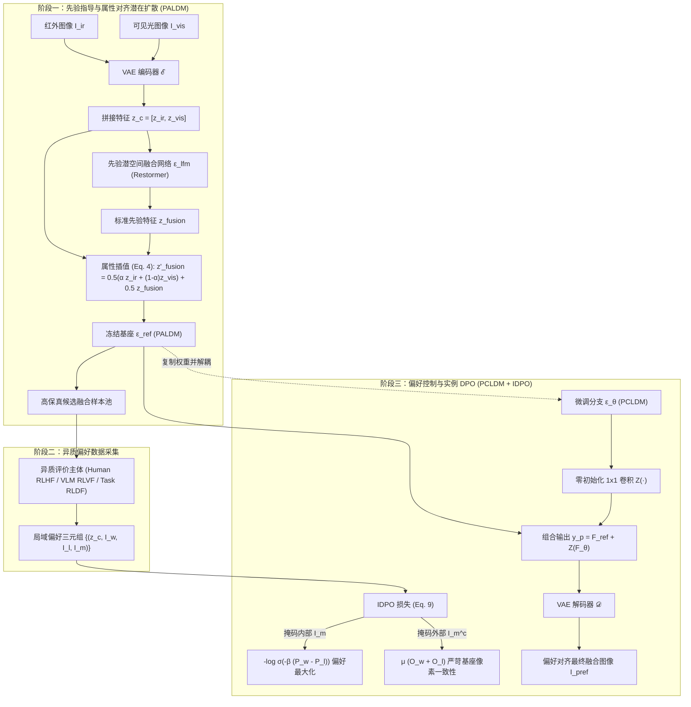

# DPOFusion：基于直接偏好优化的异质需求自适应红外-可见光图像融合

> **论文标题**：Fusion in Your Way: Aligning Image Fusion with Heterogeneous Demands via Direct Preference Optimization  
> **论文作者**：Weijian Su, Songqian Zhang, Yuqi Han*, Jian Zhuang, Yongdong Huang, Qiang Zhang*（大连理工大学计算机科学与技术学院、社会计算与认知智能教育部重点实验室，北方民族大学）  
> **发表信息**：IEEE/CVF Conference on Computer Vision and Pattern Recognition (CVPR 2026, Main Track)  
> **学术层次**：CCF-A 类 / 计算机视觉与模式识别第一盛会（依据 CCF 推荐目录第七版 2026 年）  
> **发表状态**：Accepted（官方正式录用，arXiv:2605.06049v1 [cs.CV]）  
> **原文链接**：[arXiv:2605.06049](https://arxiv.org/abs/2605.06049) ｜ [GitHub 代码](https://github.com/suweijian1996/DPOFusion) ｜ [本地 PDF](file://D:/ccqu/paper/research-lab/Ideas-2/research/daily-digest/2026-11-11/DPOFusion.pdf)  
> **综合评分**：**12 / 12 分**（研究相关性 3，核心创新与问题价值 4，机制启发 2，Venue 审查 1，可验证性 1，代码与可复现性 1）

---

## 1. 论文故事与动机还原

### 1.1 研究背景与核心矛盾

红外与可见光图像融合（IVIF）的核心任务是整合互补光谱信息：利用红外辐射突出显著热目标，利用可见光保留精细纹理与色彩，从而为人类视觉解译和下游机器感知提供高质量场景表征。

然而，在实际应用中，不同用户和下游任务对融合图像的需求呈现高度的**异质性（Heterogeneous Demands）**：
- 人类主观解译（Human Visual Perception）倾向于全局自然感、丰富的对比度与清晰的微小纹理；
- 视觉语言大模型（VLM）需要具有极高语义连贯性、与文本提示精确对应的对齐结果；
- 下游目标检测器（Object Detection）更关注高对比度的物体轮廓与边缘信噪比；
- 语义分割模型（Semantic Segmentation）则严格依赖清晰闭合的类间几何边界。

长久以来，现有方法多遵循“针对特定任务设计特定模型”的孤岛模式（如单独训练面向检测的融合网络，或单独设计面向视觉指标的损失函数）。这种模式面临根本性瓶颈：**无法用单一模型自适应满足多主体、跨任务、局域化的多样化偏好。**

### 1.2 无监督融合直接偏好优化的两大根本挑战

大语言模型（LLM）中的直接偏好优化（Direct Preference Optimization, DPO）通过构建“胜出样本 vs. 淘汰样本”的离线偏好对，省去了训练不稳定奖励模型（Reward Model）的步骤，直接在策略模型上优化相对似然对数差。但作者敏锐地指出，将 DPO 引入无监督 IVIF 面临两个未解的本质冲突：

1. **无真值约束下的解空间膨胀（Under-constrained Solution Space）**：  
   IVIF 是典型的无监督逆问题，不存在唯一的 Ground-Truth 融合图像。如果直接让扩散模型在空旷的潜在空间探索偏好，巨大的解空间会导致模型产生非物理伪影、颜色失真或语义塌陷。
2. **局域偏好适配与全局一致性的参数冲突（Local Adaptation vs. Global Consistency）**：  
   用户的偏好或下游任务的敏感点往往高度局部化（例如人类只希望修正某块路面石砖的纹理，或检测器只要求增强远处暗光行人的局部信噪比）。如果采用全局 DPO 优化网络共享参数，局部的梯度更新会无差别地扰动非偏好区域，导致背景区域结构撕裂、全局视觉连续性被破坏。

### 1.3 核心洞见与破解思路

作者的核心洞见是：**用户的具体偏好虽然千差万别，但不同主体评估融合图像基础质量的底层物理准则是内在自洽的。**

因此，系统无需重构整套融合网络，而是应当解耦为“基础生成池”与“局域偏好对齐”两个阶段：
- **阶段一（PALDM）**：先建立一个具备坚实物理基础的先验潜空间融合模型，通过“联合条件降噪损失”，在可控属性插值下生成覆盖丰富属性的高质量候选图像池（Candidate Pool）；
- **阶段二（PCLDM + IDPO）**：基于用户或下游任务在候选池中标记的局域偏好对，提出**实例级直接偏好优化（Instance DPO, IDPO）**。利用零卷积将微调分支与冻结的基座解耦，在掩码区域内执行 DPO 相对偏好优化，在掩码区域外施加强约束的像素级一致性损失，从而实现“局部按需微调、全局秋毫无犯”。

---

## 2. 方法与技术机制深度拆解

### 2.1 先验潜空间融合模型（Prior Latent Fusion Model）

为约束扩散模型的解空间，作者首先训练了一个确定性的潜空间融合先验模型 $\epsilon_{lfm}$（采用 Restormer 架构）。
输入图像对 $I_{ir}, I_{vis} \in \mathbb{R}^{H \times W \times 3}$ 经由预训练 VAE 编码器 $\mathcal{E}$ 映射为潜表征 $z_{ir}, z_{vis} \in \mathbb{R}^{h \times w \times c}$，通道拼接后形成条件张量 $z_c = [z_{ir}, z_{vis}]$。

Restormer 网络的优化由强度与梯度混合损失引导：
$$\mathcal{L}_{fusion} = \sigma_1 |\max(I_{ir}, I_{vis}) - I_{fusion}| + \sigma_2 |\max(\nabla I_{ir}, \nabla I_{vis}) - \nabla I_{fusion}|$$
其中 $\nabla$ 为 Sobel 梯度算子，$\sigma_1 = 4, \sigma_2 = 10$。该模型产出确定性先验特征 $z_{fusion} = \epsilon_{lfm}(z_c)$，解码后为扩散模型提供结构锚点。

### 2.2 属性对齐潜扩散模型（PALDM）与联合条件损失

为生成多样化且物理可控的候选融合池，作者构建了属性对齐扩散模型 $\epsilon_{ref}$。网络不仅以拼接源特征 $z_c$、时间步 $t$ 和文本提示 $c$ 为条件，还引入了属性插值机制：
$$z'_{fusion} = \frac{1}{2} \Big(\alpha \cdot z_{ir} + (1-\alpha) \cdot z_{vis}\Big) + \frac{1}{2} z_{fusion}$$
其中 $\alpha = k / (N-1)$ 是从 $N$ 级离散阶数中采样的插值系数。

作者设计了创新的**联合条件降噪损失（Joint Conditional Loss）**：
$$\mathcal{L}_c = \mathbb{E}_{z_c, k, t, \epsilon} \Big[\mathcal{L}_{denoise}(z_{fusion}, c_t) + \lambda \mathcal{L}_{denoise}(z'_{fusion}, c'_t)\Big]$$
式中 $\mathcal{L}_{denoise}(z_0, c) = \|\epsilon - \epsilon_{ref}(z_t, z_c, c, t)\|_2^2$。这一设计使得基座模型同时学会了“生成保真基准融合”与“按照文本提示定向调节红外/可见光成分”，有效填充了无真值监督下的合理采样流形。

### 2.3 偏好控制模型（PCLDM）与零卷积架构

在对齐微调阶段，基座模型 $\mathcal{F}_{ref}(\cdot; \Theta_{ref})$ 完全冻结，参数保持不变。微调模型 $\mathcal{F}_\theta(\cdot; \Theta_\theta)$ 从基座复制初始化，并通过类似 ControlNet 的**零初始化 $1 \times 1$ 卷积层** $Z(\cdot; \Theta_z)$ 跨接注入：
$$y_p = \mathcal{F}_{ref}(x, c_t; \Theta_{ref}) + Z\Big(\mathcal{F}_\theta(x, c'_t; \Theta_\theta); \Theta_z\Big)$$
**零初始化的深层机理**：在微调最初始阶段，$\Theta_z = 0$，微调分支对主干输出的影响严格为 0。这防止了微调初期剧烈、随机的偏好梯度冲击基座模型早已学好的基础融合结构。

### 2.4 实例级直接偏好优化（Instance DPO, IDPO）

这是本论文最核心的技术突破。训练数据集由四元组构成 $\mathcal{D} = \{(z_c, I_0^w, I_0^l, I_m)\}$，其中 $I_0^w \succ I_0^l$ 分别代表胜出与淘汰的图像样本，$I_m \in \{0, 1\}^{H \times W}$ 为二值偏好区域掩码（其对应降采样潜掩码为 $z_m$）。

在掩码内部，计算微调网络 $\epsilon_\theta$ 相对于冻结基准 $\epsilon_{ref}$ 的误差平方差：
$$P_w = \|(\epsilon^w - \epsilon_\theta^w) \odot z_m\|_2^2 - \|(\epsilon^w - \epsilon_{ref}^w) \odot z_m\|_2^2$$
$$P_l = \|(\epsilon^l - \epsilon_\theta^l) \odot z_m\|_2^2 - \|(\epsilon^l - \epsilon_{ref}^l) \odot z_m\|_2^2$$

在掩码外部的非偏好区域（补集 $z_m^c$），施加严苛的输出一致性惩罚：
$$O_w = \|(\epsilon_\theta^w - \epsilon_{ref}^w) \odot z_m^c\|_2^2, \quad O_l = \|(\epsilon_\theta^l - \epsilon_{ref}^l) \odot z_m^c\|_2^2$$

综合 IDPO 损失函数定义为：
$$\mathcal{L}_{IDPO} = \mathbb{E}_{\mathcal{D}, t, \epsilon} \Big[ \underbrace{-\log \sigma\Big(-\beta_t \cdot (P_w - P_l)\Big)}_{\text{掩码内偏好自适应对齐}} + \underbrace{\mu \cdot (O_w + O_l)}_{\text{掩码外严格基座一致性}} \Big]$$
其中 $\beta_t$ 为散度惩罚标度因子（对 RLHF/RLVF/Seg 设为 10，对检测设为 500），$\mu$ 为区域平衡系数。

---

## 3. 实验发现与实证评估

### 3.1 实验设置与评估基准

- **测试数据集**：涵盖 LLVIP（100 对）、MSRS（361 对）、RoadScene（121 对）、M3FD（300 对）四大综合基准；
- **对比主流基线**：横向对比 9 种代表性 SOTA 方法，包括 U2Fusion、DDFM、SHIP、EMMA、Text-IF、DCEvo、GIFNet、LUT-Fuse、SAGE；
- **评价指标体系**：
  - 感知与信息质量：熵（EN）、标准差（SD）、平均梯度（AG）、多尺度图像质量评估（MUSIQ）、卷积无参考质量评估（CNNIQA）；
  - 下游任务效能：基于 SegFormer 的语义分割 mIoU / mAcc；基于 YOLOv11 的目标检测 mAP@.5:.95 / mAP@.5。

### 3.2 实验结果核心发现

| 任务场景 | 代表性基线最佳值 | DPOFusion 表现 | 优势幅度与现象解读 |
|---|---|---|---|
| **主观视觉感知 (RLHF)** | EMMA (LLVIP SD: 50.2) / SAGE (RoadScene MUS: 37.1) | **SD: 61.91 / MUS: 43.78** | 在极端微光与复杂光照下，RLHF 对齐后的融合图像完整还原了衣物条纹与暗部反差，人眼主观自然度显著优于所有前沿竞品。 |
| **VLM 多模态指令 (RLVF)** | DCEvo (MSRS AG: 3.73) / GIFNet (RoadScene AG: 6.41) | **AG: 5.78 / AG: 8.62** | 遵循 QWEN3-Omni-Think 语言指令，平均梯度（AG）提升 34% 以上，精准呈现高频结构。 |
| **目标检测 (RLDF-OD)** | DCEvo (M3FD mAP: 42.89) / U2Fusion (mAP: 42.84) | **mAP@.5:.95: 43.40 (提升至 46.03@.75)** | 针对 YOLOv11 进行偏好微调后，高重叠密集车辆与微小灯杆漏检率大幅降低，整体检测 AP 刷新纪录。 |
| **语义分割 (RLDF-Seg)** | DCEvo (MSRS mIoU: 55.66) / EMMA (mIoU: 55.30) | **mIoU: 55.96 (mAcc: 64.26)** | SegFormer 在路边锥桶、微小凸起物上的边缘分割准确率明显改善，类间交叉熵显著下降。 |

### 3.3 关键消融实验证据

1. **IDPO vs. 全局 DPO 的决定性优势**（Table 3 & Figure 7）：  
   若退化为常规全局 DPO（无掩码分离），模型虽然能在特定指标上冲高，但非目标区域产生严重的伪对比度过冲，分割 mIoU 直接从 55.96 跌落至 55.20；而引入 IDPO 后，红框标注的偏好区域被平滑增强，绿框标注的背景区域与冻结基座保持 100% 结构一致。
2. **联合条件降噪损失 $\mathcal{L}_c$ 的有效性**（Table 3）：  
   采用属性联合降噪 $\mathcal{L}_c$ 相较于单目标损失 $\mathcal{L}_{ST}$，图像标准差 SD 从 58.21 提升至 60.81，验证了覆盖多样化属性特征的先验候选池是后续偏好对齐不可或缺的基石。

---

## 4. 创新性与研究局限分析

### 4.1 核心创新归结

1. **范式转变**：首次将直接偏好优化（DPO）从单一文本生成与文生图迁移至多模态图像融合领域，打破了以往“单一网络固定输出”或“多任务单独重训”的僵化范式；
2. **实例级解耦机制（IDPO）**：提出空间掩码调制的局部 DPO 损失与零卷积架构，成功在数学与工程上解决了“局部特定需求微调”与“全局结构稳定”的共存难题；
3. **闭环异质需求统一**：构建了涵盖人类主观（RLHF）、大模型指令（RLVF）与下游机器感知（RLDF-OD / RLDF-Seg）的通用自适应框架。

### 4.2 局限性与潜在失效

1. **二值掩码带来的界面空间梯度阶跃**：  
   IDPO 在掩码内部执行偏好似然更新，在掩码外部强制拉回冻结基座。由于掩码 $I_m \in \{0, 1\}$ 是离散阶跃函数，在掩码边界的交界像素上，优化梯度的法向导数会出现非物理跳变，容易在极端微调权重下诱发轻微的边缘光晕或拼缝伪影；
2. **离线偏好数据收集成本**：  
   构建高质量偏好对依赖于先验采样与标注（人工、VLM 或下游网络推断），若采样候选池缺乏区分度，DPO 的策略收益将明显收窄；
3. **扩散模型的多步推理开销**：  
   尽管使用了潜空间扩散，推理仍需多步降噪采样，相较于单步前向 CNN 仍存在计算延迟劣势。

---

## 5. 对我们研究的启发与 Idea 提炼

### 5.1 跨学科机制映射：弥散界面相场偏好对齐（IDEA-006）

- **融合失效痛点**：IDPO 依赖硬二值掩码 $I_m$ 分割偏好区与一致性区，在掩码外沿由于优化目标的不连续性，存在空间一阶/二阶导数发散风险（拼缝伪影）；
- **外部学科机制**：在热力学相变理论与材料界面力学中，**Cahn-Hilliard 弥散界面模型（Diffuse Interface Model）** 通过金兹堡-朗道（Ginzburg-Landau）自由能泛函描述两相过渡：
  $$\mathcal{F}[\phi] = \int \Big(f_0(\phi) + \frac{\epsilon^2}{2} |\nabla \phi|^2\Big) d\mathbf{x}$$
  其中序参量 $\phi(x,y) \in [0, 1]$ 连续渐变，界面厚度受能量梯度项严格物理约束，吉布斯-托姆森效应保证了跨相能量的处处连续。
- **机制迁移与映射**：将 IDPO 中的硬掩码 $z_m$ 替换为满足相场自由能方程的连续弥散相场 $\Phi_{field}(x,y)$。在相变界面过渡带上，构建自适应能量平滑阻尼，实现从“偏好优化域”到“背景冻结域”的物理级平滑过渡。
- **形成候选 Idea**：**[IDEA-006] 弥散界面相场偏好对齐机制（Diffuse Interface Phase-Field Preference Alignment, DIP-Align）**。

---

## 6. 研究者总结（Researcher's Takeaway）

- **一句话记住**：DPOFusion 通过“属性插值潜扩散生成多样候选”+“零卷积微调分支配合掩码级 IDPO 损失”，首次在单一框架下实现了对人类解译、大模型指令与下游检测分割的统一、自适应偏好对齐（CVPR 2026）。
- **对我们写论文的启发**：在切入新概念（如偏好对齐）时，不能盲目套用 NLP 领域的现成公式，必须先指出视觉任务的特有物理矛盾（无真值解空间膨胀 + 局部微调破坏全局一致性），再针对性提出空间解耦机制（IDPO），立论极为扎实有力。
- **后续动作**：重点跟踪并借鉴其局部掩码一致性解耦损失设计，结合相场理论深化 IDEA-006。
